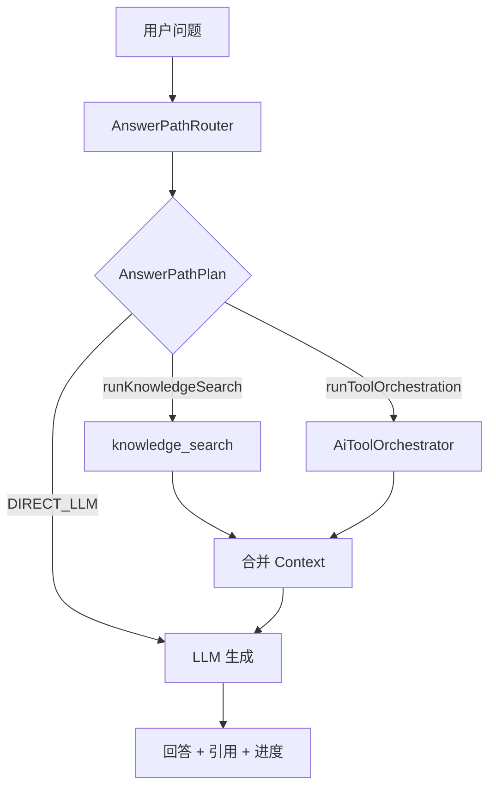

# AI 回答路径智能路由设计（LLM / RAG / Function Call）

> 文档日期：2026-10-12  
> 状态：**待评审**  
> 关联：`docs/design/2026-10-12-three-ai-features.md`、`docs/superpowers/specs/2026-10-03-automatic-rag-orchestration-design.md`、`DefaultAiHarnessService`、`AiToolOrchestrator`

---

## 1. 背景与问题

### 1.1 用户期望

在 AI 中心（Harness 对话）中，用户用自然语言或快捷问句提问时，系统应**自动**选择：

| 路径 | 典型问题 | 依赖 |
|------|----------|------|
| **纯 LLM** | 寒暄、通用健身概念（无门店/无制度依据要求） | 系统提示 + 对话历史 |
| **RAG** | 门店制度、安全规范、动作要点、合规话术 | 知识库检索 + LLM 归纳 |
| **Function Call** | 上月到店人数、会籍到期名单、流失风险会员、预约到店率 | 只读业务工具 + LLM 组织答案 |
| **混合** | 「按我们门店退课规则，本月有多少预约未签到？」 | RAG（规则）+ 工具（统计） |

用户**不应**理解或操作「先开 RAG 再开工具」；快捷卡片（如「哪些会员流失风险高？」）只是示例，路由由后端统一决策。

### 1.2 现状（代码事实）

1. **Function Call**：模型在 `AiToolOrchestrator.completeWithTools` 中决定是否调用 `gym_operations_metrics`、`member_churn_risk_list` 等只读工具——**已是模型决策**。
2. **RAG**：租户/平台 Harness 配置含 `knowledge_search` 时，**每轮**在 `contributeKnowledge` 中执行检索——**非按需**，运营类问题也会检索。
3. **纯 LLM**：工具决策返回无 tool call 且 context 较空时，由最终 `streamWithUsage` 生成；若 RAG 无结果且非 `nativeToolFlow`，可能直接返回「没有找到足够可靠的知识依据」（**误伤纯 LLM / 纯工具问题**）。
4. **角色边界**：`AiRoleProfileResolver` 定义 `enabledPlugins` 与 systemPrompt 中的工具分工说明；权限与租户隔离不变。

### 1.3 与既有「自动 RAG」文档的关系

`2026-10-03-automatic-rag-orchestration-design.md` 采用 **「始终先检索 + 再 Tool」**。本设计在其之上增加 **Answer Path Router**，实现 **按需 RAG**，并修正「无知识片段即拒答」对运营/闲聊的误伤。  
实现时可保留配置开关 **`routingMode=LEGACY`** 复现旧行为，便于对比与回滚。

---

## 2. 目标与非目标

### 2.1 目标

- 单次用户问题产出明确的 **回答路径计划（AnswerPathPlan）**，再执行 RAG / Tool / 生成。
- **运营数据、流失名单**类问题：默认 **跳过 RAG**（或仅做极低成本的「是否可能引用制度」二次判断）。
- **知识/制度/动作规范**类问题：执行 RAG；无片段时按策略降级（说明无依据 / 通用建议 disclaimer），而非一律拒答（可配置）。
- **混合问题**：允许 **RAG + Tool**（顺序：先 RAG 或先 Tool 由 plan 指定，默认先 Tool 再 RAG 补规则，或并行后合并 context）。
- 过程对前端可见：`route_decision` 进度事件（不暴露内部 prompt）。
- 单元测试覆盖：规则路由 + 与 Harness 集成的关键分支。

### 2.2 非目标（首期不做）

- 不新增用户可见的「模式切换」按钮。
- 不改变各 Tool 的 JSON Schema、SQL 白名单（见运营意图设计文档）。
- 不引入写操作 Tool、不提高 `MAX_TOOL_CALLS`（仍为 2）。
- 不做独立「路由专用大模型」微服务；路由可配置为规则优先，可选一次轻量 LLM 调用（同网关）。

---

## 3. 概念模型

### 3.1 回答路径枚举 `AnswerPath`

```text
DIRECT_LLM     // 不检索、不调业务工具（或工具阶段模型选择不调用）
KNOWLEDGE_ONLY // 仅 RAG + 生成
TOOLS_ONLY     // 仅 Function Call + 生成（可含 directAnswer 短路）
HYBRID         // RAG 与 Tool 均执行（顺序见 plan）
```

### 3.2 路由计划 `AnswerPathPlan`

```java
record AnswerPathPlan(
    AnswerPath path,
    boolean runKnowledgeSearch,      // 是否调用 knowledge_search 插件
    boolean runToolOrchestration,      // 是否进入 AiToolOrchestrator
    Set<String> preferredToolIds,    // 空=由模型在 enabled 工具集中自选
    String routeReason,              // 中文简述，供进度展示与日志
    RouteConfidence confidence       // RULE | LLM | FALLBACK
) {}
```

### 3.3 与「能力插件」映射

| 能力 ID | 路径中的角色 |
|---------|----------------|
| `basic_chat` | 始终允许最终生成 |
| `knowledge_search` | `runKnowledgeSearch=true` 时执行 |
| `gym_operations_metrics`、`member_churn_risk_list`、`course_booking_context` 等 READ Capability | `runToolOrchestration=true` 时进入 orchestrator 候选集 |
| 非 READ / 写能力 | 不在 orchestrator 候选集（保持现状） |

**硬边界**：plan 只能打开 **当前 actor 与 `enabledPlugins` 交集** 内的能力；router 不能越权。

---

## 4. 路由架构

### 4.1 总体流水线（改造后）

```text
用户问题 + 身份 + 会话历史(摘要)
  -> [1] AnswerPathRouter.resolve() -> AnswerPathPlan
  -> [2] 若 plan.runKnowledgeSearch -> contributeKnowledge()
  -> [3] 若 plan.runToolOrchestration && supportsToolCalling -> toolOrchestrator.decide(...)
        否则若需工具且不支持 FC ->  legacy plugin.contribute（现有兜底）
  -> [4] 组装 prompt + context，streamWithUsage / directAnswer 短路
  -> [5] 引用格式化（仅 RAG 片段）、记录 usage、写 chatHistory
```



### 4.2 路由器分层（推荐实现顺序）

**L0 — 安全与配置**

- 注入检测、`guard.isBlocked`：不变。
- 若租户未启用 `knowledge_search`：`runKnowledgeSearch=false`。
- 若角色无 READ 工具：`runToolOrchestration=false`。
- `gymmind.ai.harness.routing-mode`：`AUTO`（默认）| `LEGACY_ALWAYS_RAG`（兼容旧行为）。

**L1 — 确定性规则（零模型成本）**

基于归一化问句（小写、去标点、trim）与 **角色** 匹配，优先级从高到低：

| 规则 ID | 条件（示例关键词/模式） | 路径 | preferredToolIds |
|---------|-------------------------|------|------------------|
| OPS_METRICS | 会员数、到店、签到、预约率、会籍到期、上月、环比、活跃 | TOOLS_ONLY | gym_operations_metrics |
| CHURN_LIST | 流失、风险、预警、久未到店 | TOOLS_ONLY | member_churn_risk_list |
| PLATFORM_AI | 租户 AI 状态、调用量、配额（PLATFORM_ADMIN） | TOOLS_ONLY 或 DIRECT_LLM | 按现有平台能力扩展 |
| KNOWLEDGE_STRONG | 规范、制度、流程、怎么办、动作要点、安全、退课规则、依据《 | KNOWLEDGE_ONLY | — |
| CHITCHAT | 你好、谢谢、在吗 | DIRECT_LLM | — |
| FOLLOW_UP_METRICS | 上条 assistant 含数字且用户问「变化多少」「对比」 | TOOLS_ONLY | gym_operations_metrics |

规则命中时 `confidence=RULE`。

**L2 — 轻量 LLM 分类（可选，配置开启）**

当 L1 未命中且 `routing.llm-enabled=true`：

- 输入：问题 + 角色码 + 最近 1 轮对话摘要 + **可用路径说明**（不含工具参数 schema 全文）。
- 输出：**严格 JSON**（解析失败则 FALLBACK）：

```json
{
  "path": "TOOLS_ONLY | KNOWLEDGE_ONLY | DIRECT_LLM | HYBRID",
  "preferredTools": ["gym_operations_metrics"],
  "reason": "用户询问门店汇总指标"
}
```

- 使用 `ChatModelGateway.complete` 小 token 上限（如 128），不计入用户可见回答流；usage 记 `route-classifier`。
- `confidence=LLM`。

**L3 — 默认 FALLBACK**

- 店长/教练：`HYBRID`（`runKnowledgeSearch=true`, `runToolOrchestration=true`），由工具 orchestrator 与 RAG context 共同约束生成——**比当前「必 RAG + 必进 tool 决策」更省 RAG，但仍保留模糊问句能力**。
- 会员：`KNOWLEDGE_ONLY` 若启用知识库，否则 `DIRECT_LLM`。
- `confidence=FALLBACK`。

> **产品建议**：首期可只实现 L0+L1+L3，L2 作为二期；L1 规则需覆盖 `AiRoleProfile` 中全部 `quickPrompts`。

### 4.3 与 `AiToolOrchestrator` 的协作

- `preferredToolIds` 非空时：**过滤** `definitions` 为子集（至少保留 1 个；若过滤后为空则回退全量 enabled READ 工具并打 warn 日志）。
- `TOOLS_ONLY` 且 RAG 未跑：context 无知识片段时，**禁止**走「NO_CONTEXT 拒答」分支（见 §6）。
- orchestrator 返回 `directAnswer` 且 path 为 `TOOLS_ONLY`：仍可短路（现状保留）。
- `KNOWLEDGE_ONLY`：`runToolOrchestration=false`，不调用 `completeWithTools`。

### 4.4 回答规则（prompt）随路径切换

在 `DefaultAiHarnessService` 中按 plan.path 拼接 `answerRules`（替代「只要 enabled 含 knowledge_search 就加 RAG 规则」）：

| path | 规则要点 |
|------|----------|
| DIRECT_LLM | 现有「纯 AI 回答规则」 |
| KNOWLEDGE_ONLY / HYBRID（有检索） | 现有「RAG 回答规则」 |
| TOOLS_ONLY / HYBRID（有工具结果） | 现有运营/流失 tool 规则 |
| HYBRID | 同时附加 RAG + Tool 规则，并注明：**统计以工具为准，制度以知识库为准** |

---

## 5. 接口与配置变更

### 5.1 HTTP API

**无 breaking 变更**。仍使用：

- `POST /api/v1/ai/harness/chat`（及 stream 变体）
- 请求体：`sessionId`, `question`, `plugins`, `history`

**行为变更（对客户端透明）**：

- 进度事件新增阶段：`pluginId=answer_router`, `stage=route_decision`, `message=例如「识别为门店运营数据查询，跳过知识库」`。
- 无 RAG 时 citations 为空；有 RAG 时逻辑不变。

### 5.2 应用配置（`application.yml` / `GymMindAiHarnessProperties`）

```yaml
gymmind:
  ai:
    harness:
      routing-mode: AUTO          # AUTO | LEGACY_ALWAYS_RAG
      routing:
        llm-enabled: false        # 是否启用 L2 LLM 分类
        llm-max-tokens: 128
        hybrid-on-ambiguous: true # L3 店长模糊问句是否 HYBRID
        empty-knowledge-policy: DISCLOSE  # DISCLOSE | REFUSE（仅 KNOWLEDGE_ONLY）
```

### 5.3 数据库

**首期建议无表结构变更**：路由策略全局/租户级用 YAML + 现有 `tenant_harness_config.enabled_plugins` 即可。

**可选二期**：`tenant_harness_config.routing_mode VARCHAR(32)` 默认可空（继承全局）。不在首期 scope 除非产品要求 per-tenant 策略。

### 5.4 管理端

首期不改 Harness 配置 UI；平台/租户仍通过 `enabled_plugins` 控制 **能力是否可用**，不控制 **单次问句走哪条路径**。

---

## 6. 核心逻辑伪代码

### 6.1 `AnswerPathRouter`

```java
public AnswerPathPlan resolve(CurrentActor actor, AiRoleProfile profile,
                              String question, List<AiChatTurn> history,
                              List<String> enabledPlugins, RoutingConfig config) {

    if (config.routingMode() == LEGACY_ALWAYS_RAG) {
        return legacyAlwaysRagPlan(enabledPlugins);
    }

    boolean canRag = enabledPlugins.contains("knowledge_search");
    boolean canTools = hasReadTools(actor, enabledPlugins);

    Optional<AnswerPathPlan> rule = ruleEngine.match(actor, profile.roleCode(), question, history);
    if (rule.isPresent()) {
        return clamp(rule.get(), canRag, canTools);
    }

    if (config.llmEnabled()) {
        Optional<AnswerPathPlan> llm = llmClassifier.classify(question, profile, history, canRag, canTools);
        if (llm.isPresent()) return clamp(llm.get(), canRag, canTools);
    }

    return clamp(fallbackPlan(profile.roleCode(), canRag, canTools, config), canRag, canTools);
}

private AnswerPathPlan clamp(AnswerPathPlan plan, boolean canRag, boolean canTools) {
    boolean rag = plan.runKnowledgeSearch() && canRag;
    boolean tools = plan.runToolOrchestration() && canTools;
    if (!rag && !tools) {
        return new AnswerPathPlan(AnswerPath.DIRECT_LLM, false, false, Set.of(),
                "当前未启用知识库与业务工具，直接回答", RouteConfidence.FALLBACK);
    }
    return plan.withFlags(rag, tools);
}
```

### 6.2 `DefaultAiHarnessService.chat` 改造要点

```java
AnswerPathPlan plan = answerPathRouter.resolve(actor, profile, question, history, enabled, routingConfig);
progress.accept(event("answer_router", "route_decision", plan.routeReason()));

List<ContextSegment> retrievedKnowledge = List.of();
if (plan.runKnowledgeSearch()) {
    retrievedKnowledge = contributeKnowledge(...);
}

boolean nativeToolFlow = plan.runToolOrchestration()
    && authoritativeAnswer == null
    && model.supportsToolCalling() && toolOrchestrator != null;

// 删除/替换：仅当 KNOWLEDGE_ONLY 且检索为空且 policy=REFUSE 才 NO_CONTEXT 拒答
if (!nativeToolFlow && context.isEmpty() && plan.path() == AnswerPath.KNOWLEDGE_ONLY
        && emptyKnowledgePolicy == REFUSE) {
    return noContextView();
}

// tool orchestrator 传入 preferredToolIds
if (nativeToolFlow) {
    orchestration = toolOrchestrator.decide(actor, prompt, context, enabled, plan.preferredToolIds(), progress);
}
```

### 6.3 `AiToolOrchestrator` 签名扩展

```java
public AiToolOrchestrationResult decide(..., Collection<String> enabledIds,
                                        Collection<String> preferredToolIds,
                                        Consumer<AiProgressEvent> progress) {
    List<AiCapability> capabilities = filterReadTools(registry.listFor(actor, enabledIds));
    if (preferredToolIds != null && !preferredToolIds.isEmpty()) {
        capabilities = capabilities.stream()
            .filter(c -> preferredToolIds.contains(c.descriptor().id()))
            .toList();
        if (capabilities.isEmpty()) capabilities = filterReadTools(...); // 回退
    }
    // 其余同现状
}
```

---

## 7. 快捷问句与路径对照（GYM_ADMIN）

| 快捷问句 | 期望 path | preferredTool |
|----------|-----------|---------------|
| 上个月来了多少会员？ | TOOLS_ONLY | gym_operations_metrics |
| 和上上个月相比变化多少？ | TOOLS_ONLY | gym_operations_metrics |
| 哪些会员流失风险高？ | TOOLS_ONLY | member_churn_risk_list |
| 本月有哪些会员会籍快到期？ | TOOLS_ONLY | gym_operations_metrics |
| 最近预约到店率怎么样？ | TOOLS_ONLY | gym_operations_metrics |
| 训练区受伤怎么处理？ | KNOWLEDGE_ONLY | — |
| 你好 | DIRECT_LLM | — |

PLATFORM_ADMIN 快捷问句以平台能力为准；MEMBER/COACH 规则集单独维护 JSON/YAML 资源文件，便于运营调关键词而不改 Java。

---

## 8. 安全、权限与审计

- Router **不得**根据用户输入扩展 `enabledPlugins` 或绕过 `capability.supports(actor)`。
- `preferredToolIds` 仅缩小候选集，不能引入未注册工具 ID。
- 日志：`traceId`、actor、tenant、plan.path、ruleId/confidence、是否执行 RAG、调用了哪些 tool（现有 tool 日志保留）。
- 不记录完整用户问题到外部系统（与现有一致）；分类 LLM 输入同 harness 数据保留策略。

---

## 9. 测试策略

| 类型 | 内容 |
|------|------|
| 单元测试 | `AnswerPathRouterRuleEngineTest`：各 quickPrompt 命中 TOOLS_ONLY/KNOWLEDGE_ONLY |
| 单元测试 | `clamp`：无 knowledge_search 时 KNOWLEDGE_ONLY 降级 |
| 集成测试 | Mock `ChatModelGateway`：`TOOLS_ONLY` 问题不调用 knowledge 插件 contribute |
| 集成测试 | RAG 空结果 + `TOOLS_ONLY` 仍返回工具驱动答案 |
| 回归 | `AiToolOrchestratorTest` 扩展 preferredToolIds 过滤 |
| 配置回归 | `LEGACY_ALWAYS_RAG` 与当前生产行为一致 |

可选：在 `docs/rag-eval/queries.json` 增加路由标签字段，用于离线评估误路由率。

---

## 10. 实施阶段建议

| 阶段 | 交付 | 风险 |
|------|------|------|
| **P1** | `AnswerPathRouter`（L0+L1+L3）+ Harness 接入 + NO_CONTEXT 修正 + 进度事件 | 规则漏网 → FALLBACK HYBRID |
| **P2** | L2 LLM 分类 + 配置项 + usage 计量 | 分类 JSON 不稳定 → 严格 schema + fallback |
| **P3** | 规则外置 YAML、per-tenant routing_mode、路由质量看板 | 运维复杂度 |

---

## 11. 验收标准

1. 店长快捷问句「上个月来了多少会员？」：**不触发**知识库检索进度（或显示「已跳过知识库」），**触发**运营工具决策/调用。
2. 「训练区安全规范是什么？」：**触发** RAG，回答带 citations（有资料时）。
3. 「你好」：**不** RAG、**不**调工具，简短回复。
4. `routing-mode=LEGACY_ALWAYS_RAG` 时行为与改造前一致（每轮检索 + tool 流程不变）。
5. 权限隔离、Tool SQL 白名单、MAX_TOOL_CALLS=2 无回归。
6. 后端相关测试通过；前端无需改交互即可看到新进度文案（可选优化展示）。

---

## 12. 待评审决策点

请产品/研发确认：

1. **L3 店长模糊问句**默认 `HYBRID` 还是 `KNOWLEDGE_ONLY`？（本设计默认 HYBRID + 可配置）
2. **知识库无结果**时：`KNOWLEDGE_ONLY` 用 `DISCLOSE`（说明无依据 + 通用建议）还是 `REFUSE`（硬拒）？
3. **首期是否实现 L2 LLM 分类**，还是 P1 仅规则 + FALLBACK？
4. 混合问句（制度+统计）首期是否支持 `HYBRID` 双执行，还是先规则拆分为单路径？

---

**评审通过后**进入编码计划（文件清单、任务拆解），再实施代码变更。
